# Tether

**노트와 수치, 사람에 대한 기록을 한곳에 두고 서로 이어 주는 macOS 앱.**
글을 쓰다가 그 자리에 표·그래프·애널리틱스를 끼워 넣고, 한쪽에서 한 일을 다른 쪽의 숫자와 연결합니다.

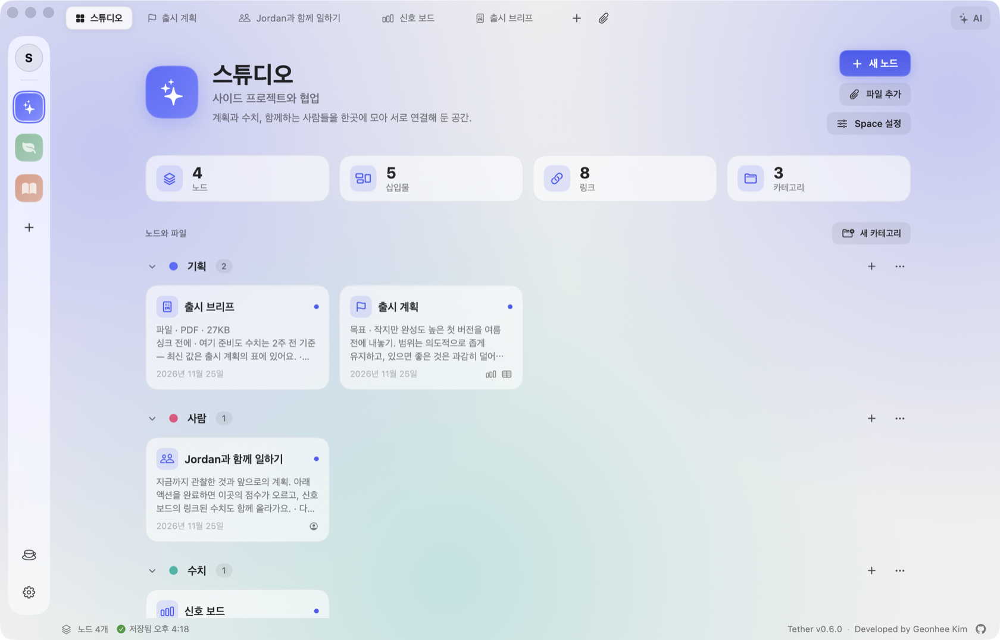

> 스크린샷은 모두 앱에 내장된 **가상의 예시 데이터**로 찍었습니다 ([다시 만드는 법](#스크린샷-다시-만들기)).

- macOS 14 이상
- macOS 26에서는 Liquid Glass, 그 이전 버전에서는 블러 머티리얼로 표시
- 한국어 / English
- 모든 데이터는 이 Mac 안에만 저장 — [AI 어시스턴트](#ai-어시스턴트)를 연결해 메시지를 보낼 때만, 선택한 서비스로 필요한 내용이 전송됩니다

---

## 목차

1. [계정과 Space](#계정과-space)
2. [노드](#노드)
3. [카테고리](#카테고리)
4. [파일](#파일)
5. [삽입 — 표 · 그래프 · 애널리틱스](#삽입--표--그래프--애널리틱스)
6. [링크](#링크)
7. [AI 어시스턴트](#ai-어시스턴트)
8. [테마와 설정](#테마와-설정)
9. [절전 방지 모드](#절전-방지-모드)
10. [글과 삽입물이 한 장처럼 흐르게](#글과-삽입물이-한-장처럼-흐르게)
11. [설치와 빌드](#설치와-빌드)
12. [데이터와 개인정보](#데이터와-개인정보)
13. [프로젝트 구조](#프로젝트-구조)

---

## 계정과 Space

| 로그인 | 비밀번호 재설정 | Space 설정 |
| --- | --- | --- |
| 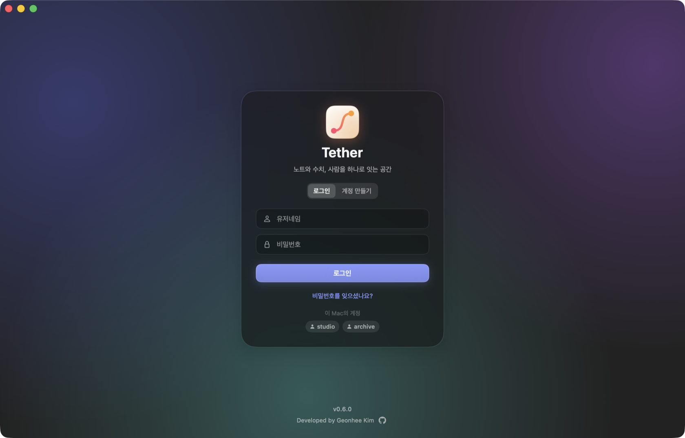 |  | 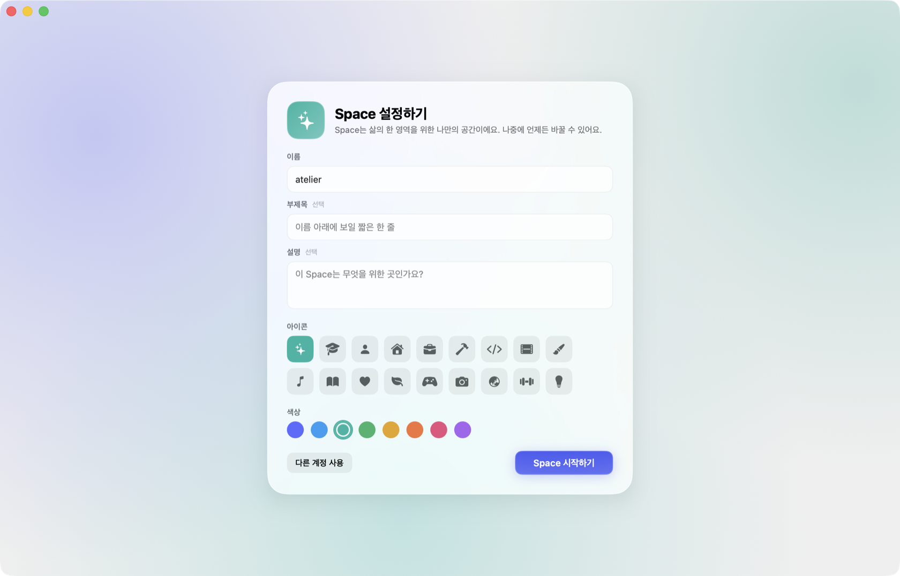 |

- **유저네임 + 비밀번호**로 로그인합니다. 이메일은 선택 사항입니다.
- 계정은 최대 **10개**, 계정 하나 안에 Space를 최대 **10개**까지 만들 수 있습니다. 구조는 **계정 › Space › 카테고리 › 노드** 순입니다.
- **여러 계정에 동시에 로그인**해 둘 수 있습니다. 로그인 상태와 마지막으로 보던 Space는 앱을 다시 켜도 유지됩니다.
- 처음 로그인하면 첫 Space의 **이름, 부제목(선택), 설명, 아이콘, 색상**을 정합니다. 나중에 Space 홈의 *Space 설정*에서 언제든 바꿀 수 있습니다.
- 비밀번호는 원문이 아니라 솔트를 섞어 반복 해시한 값만 저장합니다.
- **비밀번호를 잊었다면** 로그인 화면의 *비밀번호를 잊으셨나요?* 에서 새로 정할 수 있습니다. macOS가 Touch ID 또는 Mac 로그인 암호로 본인을 확인한 뒤에만 바뀌며, Space의 내용은 그대로 남습니다. 로그인된 상태라면 *계정과 Space 관리 › 비밀번호 변경*에서 바로 바꿉니다.

### 한 계정에 여러 Space

| 계정과 Space 관리 | 새 Space |
| --- | --- |
| 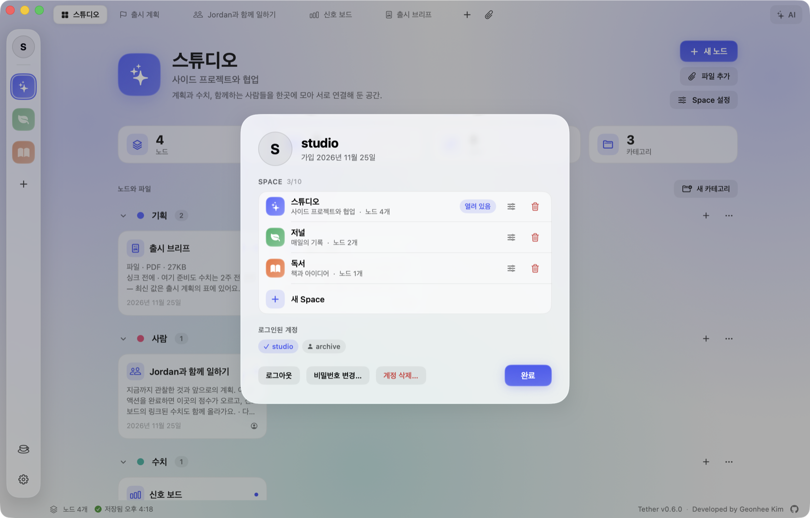 | 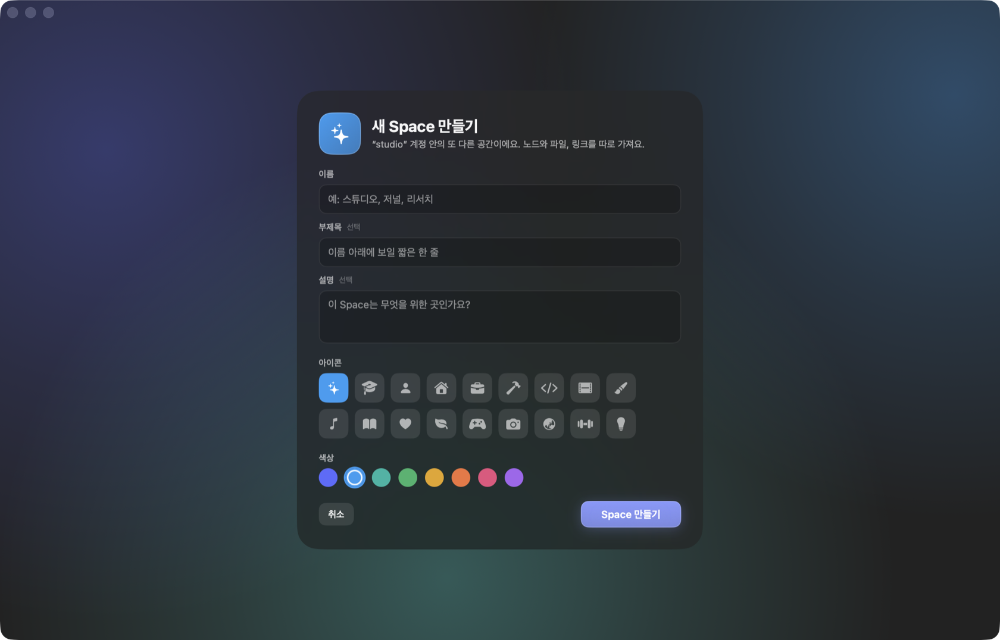 |

- 왼쪽 레일 맨 위의 **계정 버튼** 아래로 그 계정의 Space가 나란히 놓이고, 클릭 한 번으로 오갑니다.
- 레일의 **+** 또는 `⇧⌘N`으로 Space를 추가합니다. Space마다 노드 · 파일 · 카테고리 · 링크 · 실행 취소 기록이 따로입니다.
- 계정 버튼을 누르면 로그인된 **다른 계정으로 전환**하거나 계정을 추가하고, *계정과 Space 관리*를 열 수 있습니다. 여기서 Space를 열고 · 설정하고 · 삭제하며, 비밀번호 변경 · 로그아웃 · 계정 삭제도 합니다.
- Space의 순서는 레일에서 우클릭해 위아래로 옮깁니다. 계정에는 Space가 하나 이상 있어야 하므로 마지막 하나는 지울 수 없습니다.
- 이전 버전에서 만든 계정은 그대로 열리고, 쓰던 Space가 그 계정의 첫 번째 Space가 됩니다.

Space 홈에는 노드 목록, 삽입물·링크 개수, 그리고 노드들이 어떻게 이어져 있는지 보여 주는 **연결 지도**가 있습니다.

## 노드

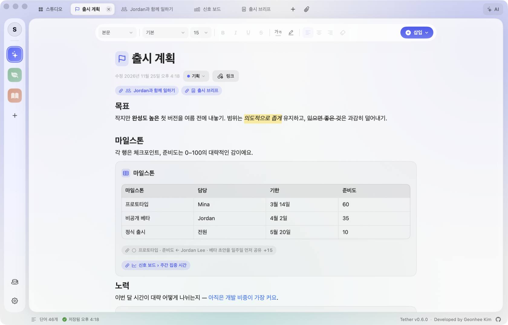

브라우저의 탭처럼, 상단의 **+** 로 새 노드를 엽니다 (`⌘T`). 노드는 빈 페이지에서 시작하는 노트입니다.

- **서식** — 굵게 · 기울임 · 밑줄 · 취소선 · 글자 색 · 형광펜 · 글꼴 · 크기 · 정렬 · 문단 스타일(제목/머리글/소제목/본문)
- 한글에도 기울임이 적용됩니다.
- 탭을 닫아도 노드는 지워지지 않고 Space 홈에 남습니다. 삭제는 탭이나 노드 카드의 우클릭 메뉴에서 합니다.
- 입력하는 즉시 자동 저장되고, `⌘S`로 바로 저장할 수도 있습니다.
- **실행 취소 `⌘Z` / 다시 실행 `⇧⌘Z`** 는 글자 입력뿐 아니라 Space 안의 모든 편집에 통합니다 — 서식, 삽입물 추가·삭제, 표의 칸, 그래프 값, 액션 체크, 링크, 삭제한 노드까지 방금 한 일부터 차례로 되돌립니다. 다른 노드에서 일어난 변경이면 그 노드로 이동해 보여 줍니다.

| 단축키 | 동작 |
| --- | --- |
| `⌘T` / `⌘W` | 새 노드 / 노드 탭 닫기 |
| `⌘O` | 파일 추가 |
| `⇧⌘H` | Space 홈 |
| `⇧⌘N` | 새 Space |
| `⌘Z` / `⇧⌘Z` | 실행 취소 / 다시 실행 |
| `⌘S` | 지금 저장 |
| `⇧⌘K` | 절전 방지 모드 |
| `⌘J` | AI 어시스턴트 |
| `⌘B` `⌘I` `⌘U` | 굵게 · 기울임 · 밑줄 |
| `⇧⌘X` / `⇧⌘\` | 취소선 / 서식 지우기 |
| `⌘,` | 설정 |

## 카테고리

Space 안의 노드는 **카테고리**로 묶을 수 있습니다 (맨 위 스크린샷의 *기획 · 사람 · 수치*).

- Space 홈의 *새 카테고리*로 만들고, 이름은 그 자리에서 바로 고칩니다. 색 점을 누르면 색을 바꿉니다.
- 노드를 카테고리에 넣는 방법 — 노드 제목 아래의 **카테고리 버튼**, 탭이나 홈 카드의 우클릭 메뉴, 또는 카테고리 머리글의 **+** 로 그 안에 바로 새 노드 만들기
- 카테고리는 접었다 펼 수 있고(상태가 저장됩니다), **⋯** 메뉴에서 순서를 바꾸거나 삭제합니다. 카테고리를 삭제해도 그 안의 노드는 *미분류*로 남습니다.
- 글로 쓴 노드와 파일 노드 모두 넣을 수 있고, 연결 지도에서는 노드 아이콘이 카테고리 색을 띱니다.
- 카테고리를 만들고 · 옮기고 · 지우는 것도 `⌘Z`로 되돌립니다.

## 파일

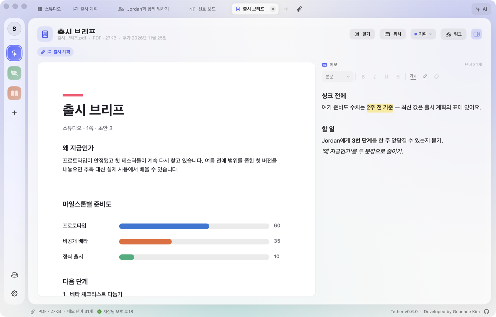

글로 쓴 노드뿐 아니라 **파일도 노드처럼** Space에 넣고 탭으로 열어 볼 수 있습니다. 파일 옆에는 **메모**를 적는 칸이 있습니다.

- **추가하는 방법** — 탭 줄의 클립 버튼, `⌘O`, Space 홈의 *파일 추가*, 또는 창 위로 파일을 **끌어다 놓기** (여러 개 한꺼번에 가능)
- **볼 수 있는 형식** — PDF, 이미지, 텍스트·코드, 오피스 문서, 오디오, 동영상 등 macOS의 훑어보기(Quick Look)가 지원하는 형식
- 파일은 Space 안으로 **복사**되므로 원본을 옮기거나 지워도 그대로 열립니다.
- **메모** — 파일을 보면서 오른쪽 칸에 바로 적습니다. 문단 스타일 · 굵게 · 기울임 · 밑줄 · 취소선 · 글자 색 · 형광펜을 쓸 수 있고, 자동 저장과 `⌘Z`도 일반 노드와 같습니다. 메모의 첫 줄은 Space 홈의 카드에도 보이며, 머리글 오른쪽 버튼으로 칸을 숨겨 파일을 넓게 볼 수 있습니다.
- 파일 노드도 다른 노드나 삽입물과 [링크](#링크)할 수 있고, Space 홈의 연결 지도에 함께 나타납니다.
- 제목은 자유롭게 바꿀 수 있으며, *열기*는 기본 앱으로, *위치*는 Finder에서 보여 줍니다.
- 파일 노드를 삭제해도 `⌘Z`로 되살릴 수 있습니다. 실제 파일은 앱을 종료하거나 로그아웃할 때 정리됩니다.

## 삽입 — 표 · 그래프 · 애널리틱스

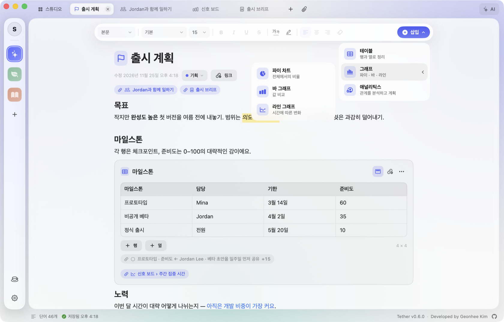

툴바의 **삽입**에 마우스를 올리면 메뉴가 펼쳐지고, *그래프*에 올리면 파이 · 바 · 라인이 옆으로 나옵니다. 고른 항목은 **커서가 있던 자리**에 들어갑니다.

### 표

행과 열을 자유롭게 늘리고(우클릭으로 중간 삽입·삭제), 머리글 행을 켜고 끌 수 있습니다. 숫자가 들어 있는 칸은 [값 링크](#링크)의 대상이 될 수 있습니다.

### 그래프

| 파이 | 라인 |
| --- | --- |
| 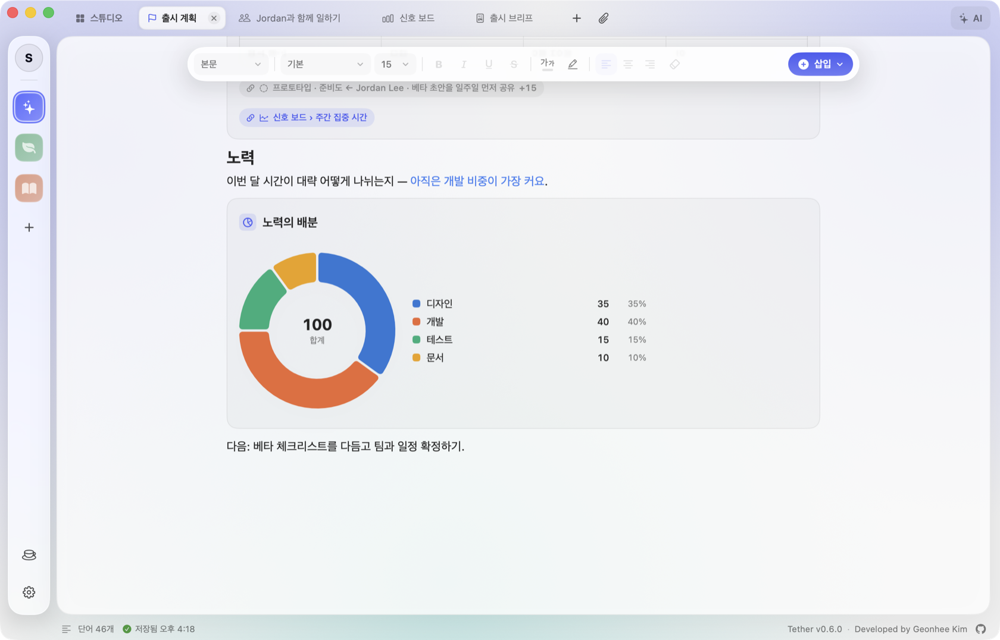 | 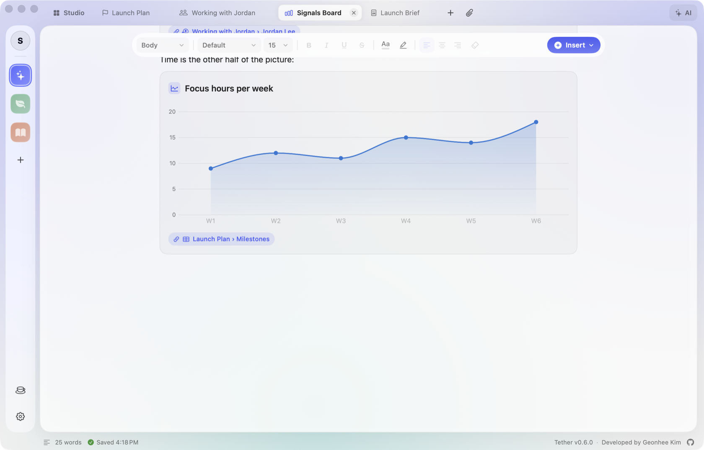 |

- 파이 · 바 · 라인을 삽입 후에도 언제든 전환할 수 있습니다.
- 값 편집 패널에서 이름·값·색을 바꾸면 그래프가 부드럽게 따라 움직입니다.
- 마우스를 올리면 해당 항목이 강조되고 값이 표시됩니다.
- 색상은 색각 이상에서도 구분되도록 검증한 8색 팔레트이며, 라이트/다크 각각 따로 맞춘 값을 씁니다.

### 애널리틱스

| 프로필과 점수 | 액션 플랜과 관찰 기록 |
| --- | --- |
| 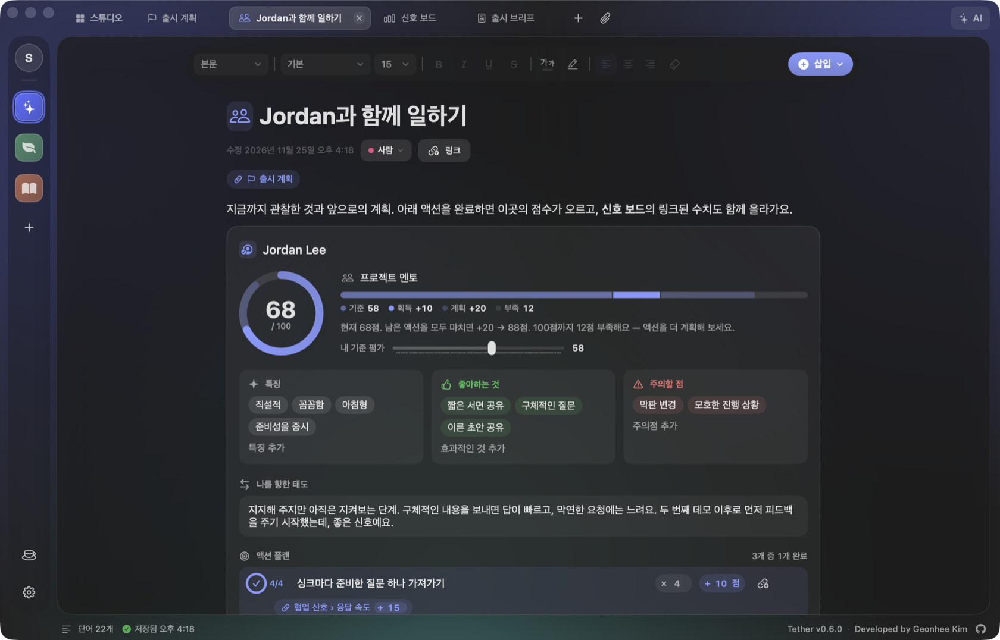 | 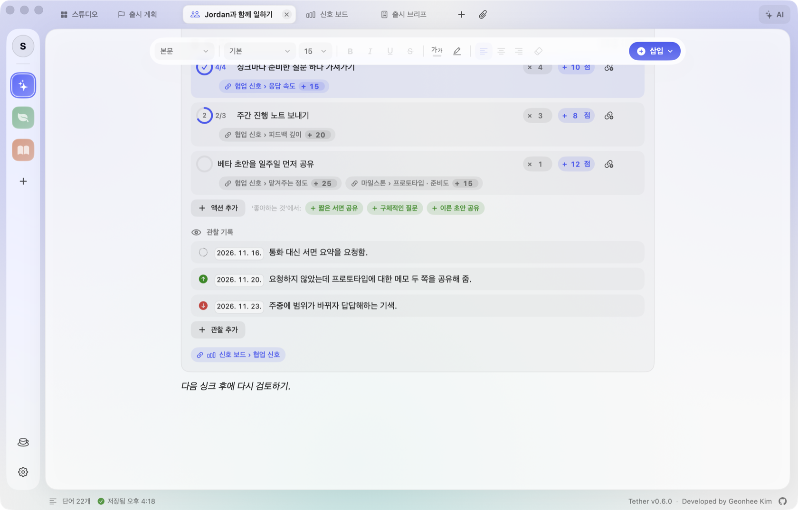 |

한 사람과의 관계를 정리하고, **무엇을 하면 더 나아질지** 계획하는 카드입니다.

- **이름 · 관계**와 내가 매기는 **기준 평가**(0–100)
- **특징 / 좋아하는 것 / 주의할 점** 태그, **나를 향한 태도**에 대한 메모
- **관찰 기록** — 날짜별로 긍정 · 중립 · 부정 신호를 남깁니다.
- **액션 플랜** — “무엇을 몇 번” 형태의 조건입니다. 목표 횟수를 채우면 정해 둔 점수가 더해집니다.
- 점수 링과 막대가 **기준 → 획득 → 계획 → 부족**을 한눈에 보여 주고, “남은 액션을 모두 마치면 몇 점, 100점까지 몇 점 부족”인지 알려 줍니다.
- *좋아하는 것*에 적어 둔 항목은 클릭 한 번으로 액션 후보가 됩니다.

## 링크

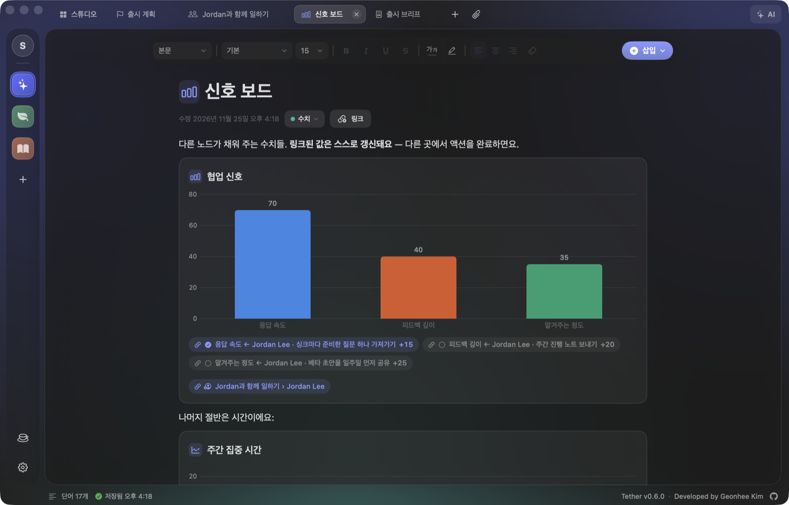

Tether의 링크는 두 종류입니다.

**참조 링크** — 노드 ↔ 노드, 노드 ↔ 삽입물, 삽입물 ↔ 삽입물을 양방향으로 잇습니다. 칩을 누르면 반대편으로 이동하고, 해당 삽입물이 잠깐 빛나며 위치를 알려 줍니다.

**값 링크** — 애널리틱스의 액션에 “완료하면 *저 값*을 얼마만큼 바꾼다”를 걸어 둡니다. 대상은 다음 셋 중 하나입니다.

- 그래프의 한 항목
- 표의 숫자 칸
- 다른 애널리틱스의 점수

예시 화면에서는 한 노드의 액션 *“싱크마다 준비한 질문 하나 가져가기 ×4”* 를 채우자, 다른 노드에 있는 바 그래프의 *응답 속도* 가 55 → 70으로 올라갔습니다. 아직 끝나지 않은 액션은 회색 칩으로 “완료 시 +20”처럼 예고만 해 둡니다.
링크된 값은 원래 값을 덮어쓰지 않고 그 위에 더해 보여 주므로, 액션을 되돌리면 값도 원래대로 돌아옵니다.

## AI 어시스턴트

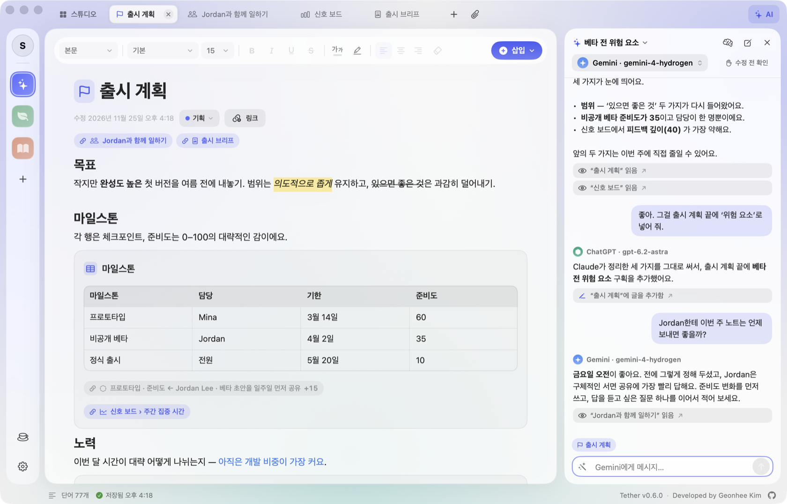

탭 줄 오른쪽의 **AI** 버튼이나 `⌘J`로 노드 옆에 어시스턴트를 엽니다. **Claude · ChatGPT · Gemini**, 그리고 이 Mac에서 도는 **로컬 모델(Ollama)** 을 연결해, Tether의 화면 안에서 같은 방식으로 씁니다.

### 서로 다른 모델이 같은 것을 봅니다

- **대화 하나를 여러 모델이 이어받습니다.** 답변할 모델은 패널 위에서 언제든 바꿀 수 있고, 다음 모델은 그때까지의 대화를 — 다른 모델이 한 답과 한 일까지 — 그대로 읽습니다. 위 화면에서는 Claude가 정리한 내용을 ChatGPT가 노드에 넣고, Gemini가 이어서 답합니다.
- **Space의 노드를 함께 봅니다.** 모든 모델이 같은 노드 목록과 열린 노드를 받고, 필요한 노드는 직접 읽습니다. 표 · 그래프(링크된 값 포함) · 애널리틱스, 파일 노드의 PDF · 텍스트 내용과 메모까지 읽을 수 있습니다.
- **공유 메모리.** 오래 쓸 만한 사실(선호, 결정)은 계정마다 하나인 메모리에 저장되어 어떤 모델에게든 전달됩니다. 모델이 스스로 저장하기도 하고, 패널의 뇌 모양 버튼에서 직접 추가 · 삭제할 수 있습니다.
- 이전 대화는 Space마다 보관되며, 모델이 검색하고 다시 읽을 수 있습니다.

### 노드에서 함께 작업하기

| 수정 전 확인 | AI 설정 |
| --- | --- |
| 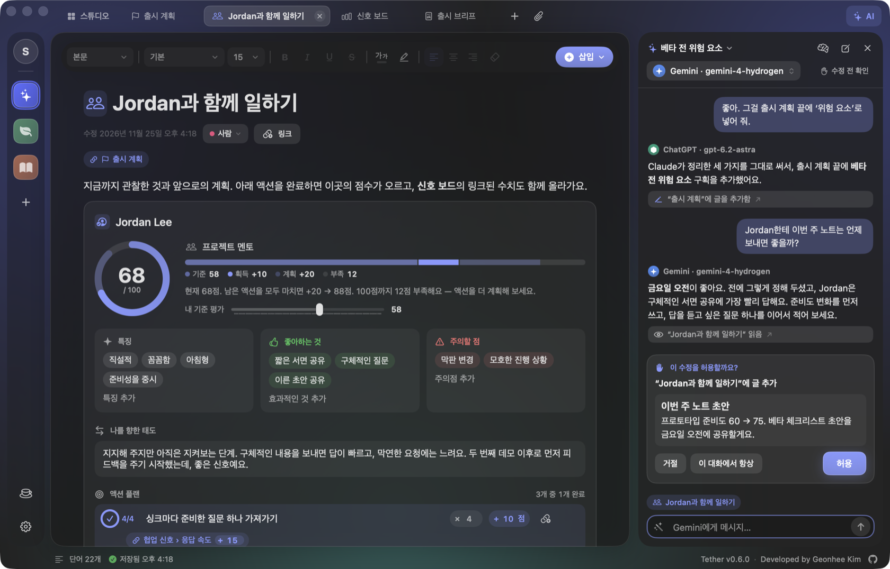 | 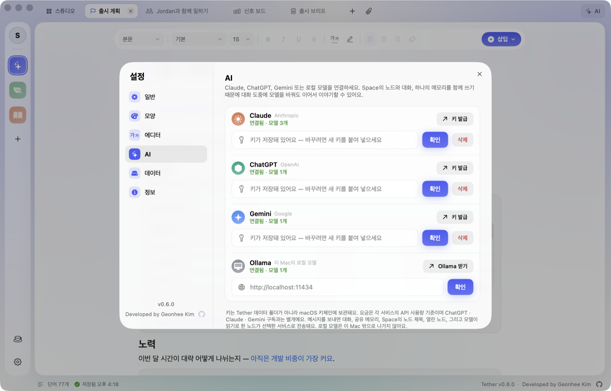 |

모델은 읽기만 하는 것이 아니라 노드를 직접 고칠 수 있습니다 — 새 노드 만들기, 글 덧붙이기, 일부 문장 바꾸기, 제목 · 카테고리 변경, 표 · 그래프 추가, 노드끼리 링크.

- 모델이 한 일은 답변 아래에 한 줄씩 남고, 누르면 그 노드로 이동합니다.
- 모델의 수정도 내가 한 편집과 똑같이 자동 저장되고 **`⌘Z`로 되돌립니다.**
- 권한은 세 단계입니다 — **읽기만 / 수정 전 확인(기본) / 바로 수정.** ‘수정 전 확인’에서는 바뀔 내용을 먼저 보여 주고 허용할 때만 적용합니다.
- 답변에 마우스를 올리면 그 내용을 열린 노드에 바로 덧붙이거나 복사할 수 있습니다.

### 모델 · 스킬 · MCP

- **모델 선택** — 연결한 서비스가 지금 제공하는 모델 목록을 그대로 불러와 고릅니다.
- **스킬** — 다시 쓰는 지시문입니다. 입력창에서 골라 실행하거나, 요청에 맞는 스킬을 모델이 스스로 불러옵니다. 어떤 모델에서든 똑같이 동작하며 *설정 › AI*에서 만들고 고칩니다.
- **MCP 서버** — Model Context Protocol 서버의 도구를 모든 모델에게 제공합니다. 이 Mac에서 실행하는 로컬 서버(명령)와 원격 서버(주소)를 지원합니다. 로그인이 필요한 원격 서버는 아직 지원하지 않습니다.

### 연결과 요금, 전송되는 내용

- *설정 › AI*에서 서비스별 **API 키**를 붙여 넣어 연결합니다. 키는 데이터 폴더가 아니라 **macOS 키체인**에 저장되어 백업에 포함되지 않습니다.
- 요금은 각 서비스의 API 사용량 기준이며, ChatGPT · Claude · Gemini **구독과는 별개**입니다. Ollama의 로컬 모델은 키도 요금도 없고 이 Mac 밖으로 아무것도 보내지 않습니다.
- 메시지를 보낼 때 선택한 서비스로 가는 것: 그 대화, 공유 메모리, Space의 노드 **제목 목록**, 열린 노드의 내용(입력창 위의 칩으로 끌 수 있음), 그리고 모델이 읽기로 한 노드. 연결하지 않으면 아무것도 전송되지 않습니다.

## 테마와 설정

| 모양 | 정보 |
| --- | --- |
| 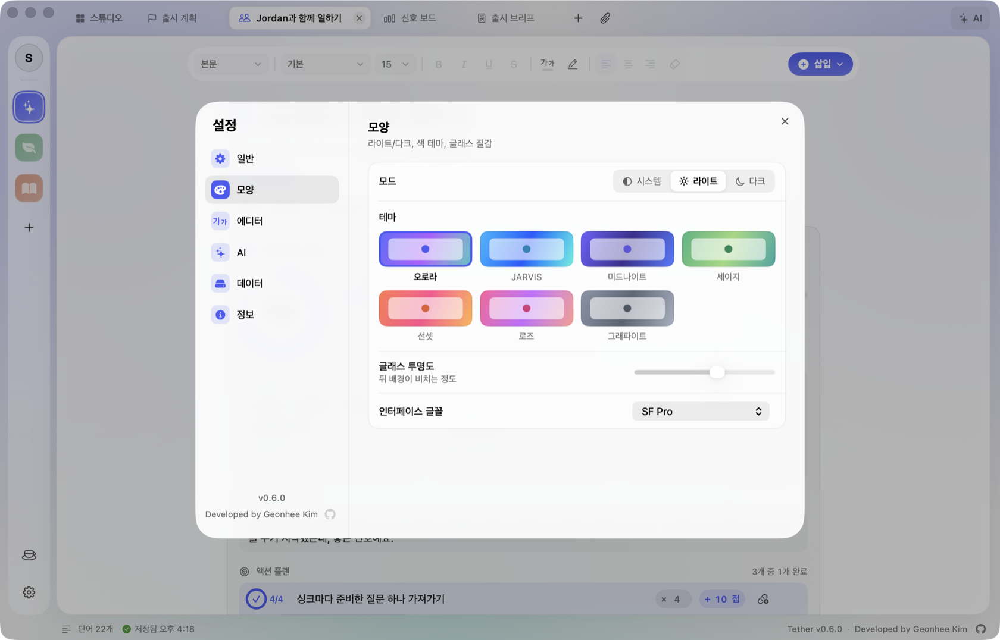 | 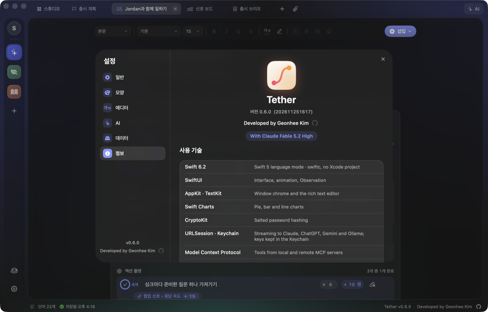 |

| Sunset · 다크 | Sage · 라이트 |
| --- | --- |
| 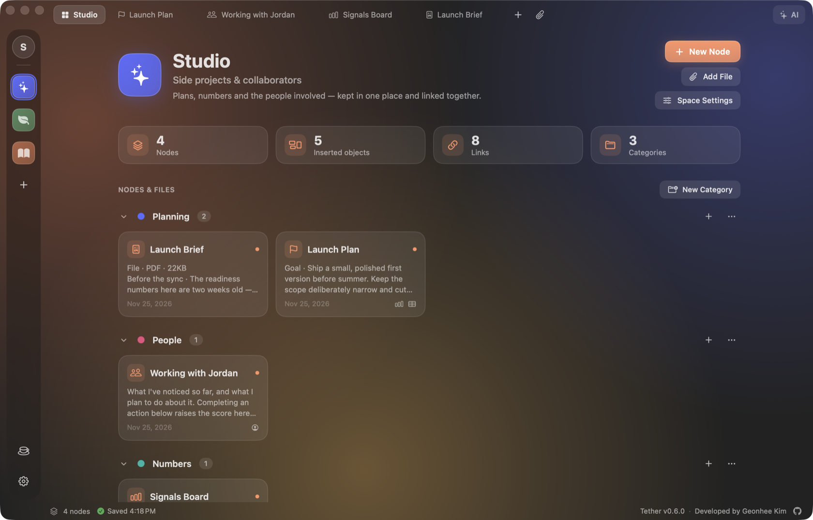 | 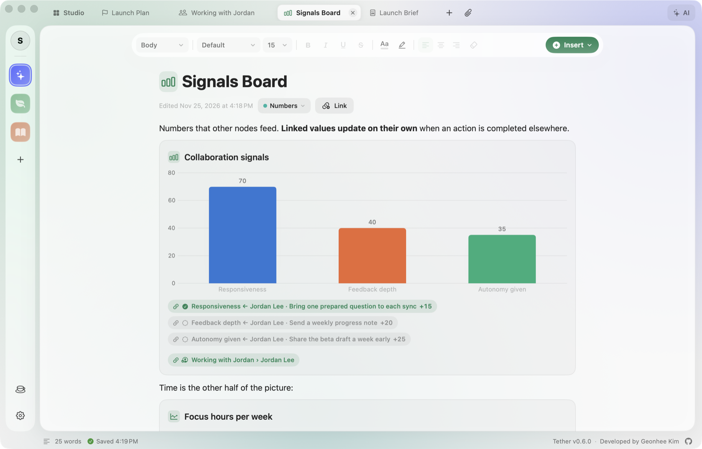 |

- **일반** — 언어(한국어 / English, 즉시 적용), 애니메이션, 배경 조명 움직임
- **모양** — 시스템 / 라이트 / 다크, 색 테마 7종(Aurora · JARVIS · Midnight · Sage · Sunset · Rose · Graphite), 글래스 투명도, 인터페이스 글꼴
- **에디터** — 본문 글꼴, 글자 크기, 줄 간격, 페이지 너비, 맞춤법 검사 (직접 지정한 글꼴·크기는 유지되고 나머지 글만 따라 바뀝니다)
- **AI** — 서비스 연결, 모델이 할 수 있는 일, 스킬, MCP 서버
- **데이터** — 데이터 폴더 열기, 전체 백업 내보내기, 계정 관리
- **정보** — 버전, 개발자, 사용 기술

글래스 스타일은 [ATFM](https://github.com/geonhee15/ATFM)의 카드 · 칩 · 틴트 구성을 가져와 확장한 것입니다. 창 전체 뒤로 데스크톱 블러와 테마 색 조명이 깔리고, 레일 · 툴바 · 메뉴 같은 떠 있는 요소만 유리로, 글을 쓰는 면은 더 불투명하게 처리해 가독성을 지킵니다.

## 절전 방지 모드

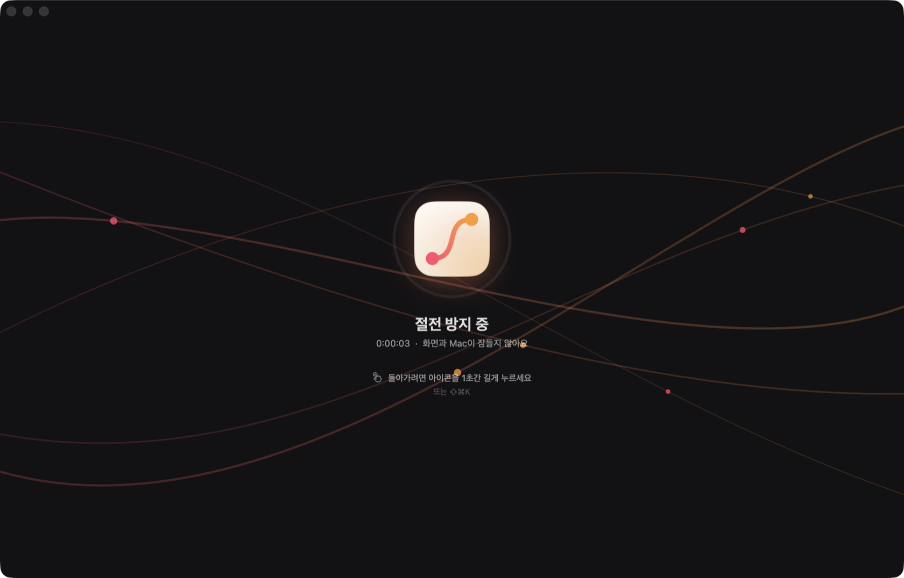

`⇧⌘K` 또는 왼쪽 레일의 컵 버튼을 누르면 Mac과 화면이 잠들지 않게 붙잡아 두고, 창은 아이콘과 천천히 휘어지는 곡선만 남은 화면으로 바뀝니다. 그동안 작업 중이던 내용은 화면에 보이지 않습니다.

- 돌아가려면 화면 안내대로 **아이콘을 1초간 길게 누릅니다** (누르는 동안 테두리가 차오릅니다). `⇧⌘K`를 다시 눌러도 됩니다.
- 돌아가거나 앱을 종료하면 절전 방지도 함께 풀립니다.
- 덮개를 닫거나 직접 잠자기를 선택하는 경우는 막지 않습니다.

## 글과 삽입물이 한 장처럼 흐르게

삽입물이 들어가면 문서가 “글 + 상자들”로 끊겨 보이기 쉽습니다. 어색해지는 지점과 해결 방식은 다음과 같습니다.

| 어색해지는 지점 | 해결 |
| --- | --- |
| 삽입물이 페이지 위에 얹힌 상자처럼 보임 | 테두리와 그림자 대신 옅은 음영으로 페이지에 *파인* 것처럼 표현 |
| 편집 버튼이 항상 보여 산만함 | 버튼은 마우스를 올렸을 때만 나타남 — 평소에는 인쇄된 그림처럼 보임 |
| 글과 삽입물의 폭·여백이 어긋남 | 같은 단(column)과 같은 좌우 기준선, 같은 위아래 간격 사용 |
| 삽입물 안의 글꼴이 본문과 다름 | 제목 · 셀 · 태그 모두 본문 글꼴 설정을 따름 |
| 삽입 후 커서가 어디 갔는지 모름 | 커서 위치에서 글을 둘로 나눠 그 사이에 넣고, 커서는 바로 아래로 이어짐 |
| 삽입물을 지우면 빈 줄과 끊긴 문단이 남음 | 위아래 글을 다시 한 덩어리로 합침 |
| 방향키가 삽입물 앞에서 막힘 | ↑ ↓ 가 삽입물을 건너 다음 글로 이동, 페이지 빈 곳을 누르면 맨 끝에서 이어 쓰기 |
| 떠 있는 툴바 아래로 글이 비쳐 읽기 어려움 | 유리 위에 반투명 막을 한 겹 더해 아래 내용이 방해하지 않게 함 |

애니메이션은 탭 전환, 삽입 · 삭제, 점수와 그래프의 변화, 호버 반응처럼 **상태가 바뀌는 순간**에만 짧게 들어가며, 설정에서 끌 수 있고 시스템의 “동작 줄이기”도 따릅니다.

## 설치와 빌드

Xcode 없이 Command Line Tools만으로 빌드합니다.

```bash
git clone https://github.com/geonhee15/Tether.git
cd Tether
./build.sh          # 릴리스 빌드 → /Applications/Tether.app 에 설치
./build.sh --run    # 빌드 후 바로 실행
./build.sh debug    # 디버그 빌드 (build/Tether.app, 설치하지 않음)
```

- 필요: macOS 14+, Swift 5.9 이상 (`xcode-select --install`)
- 설치 위치를 바꾸려면 `TETHER_INSTALL_DIR=~/Applications ./build.sh`
- 버전은 `VERSION` 파일 한 곳에서 관리합니다 (`major.minor.patch`).

## 데이터와 개인정보

```
~/Library/Application Support/Tether/
├── accounts.json        계정 (비밀번호는 해시만)과 계정별 Space 목록
├── session.json         로그인된 계정과 지금 앞에 있는 계정
├── spaces/<id>.json     Space 하나의 설정 · 카테고리 · 노드 · 링크
├── files/<id>/          그 Space에 추가한 파일의 사본
└── ai/                  AI 설정 · 스킬 · MCP 서버, Space별 대화, 계정별 공유 메모리 (API 키는 여기 없고 키체인에 있음)
```

- AI 서비스를 연결하지 않으면 네트워크 요청이 없습니다. 연결한 뒤에는 모델 목록을 불러올 때와 메시지를 보낼 때만 해당 서비스와 통신합니다 ([전송되는 내용](#연결과-요금-전송되는-내용)).
- 이 저장소에는 **앱 코드와 가상의 예시 데이터만** 들어 있습니다. 사용자가 실제로 쓴 내용은 위 폴더에만 있고 저장소에 포함되지 않습니다.

### 스크린샷 다시 만들기

```bash
./build.sh debug && Scripts/screenshots.sh
```

데모 모드는 임시 폴더와 별도의 설정 공간을 쓰기 때문에 실제 계정 · Space · 설정을 읽거나 건드리지 않습니다. 예시 내용은 `Sources/Tether/App/Demo.swift`에 있습니다.

## 프로젝트 구조

```
Sources/Tether/
├── App/        진입점, 창과 메뉴, 화면 상태, 데모 데이터
├── Model/      데이터 모델, Space/노드 모델, 저장소(계정 · 자동 저장)
├── Support/    설정, 언어, 앱 정보
├── UI/         테마와 글래스, 로그인, 계정 · Space 설정 · 홈 · 카테고리, 설정, 공통 컴포넌트
├── Editor/     텍스트 엔진, 노드 페이지와 툴바, 표 · 그래프 · 애널리틱스, 링크
└── AI/         서비스별 연결(Claude · ChatGPT · Gemini · Ollama), 대화 엔진과 공유 컨텍스트, 노드 도구, MCP
Scripts/        아이콘 생성, 스크린샷, 검사용 모의 서버
build.sh        빌드 · 서명 · 설치
```

**사용 기술** — Swift · SwiftUI · AppKit(TextKit) · Swift Charts · Observation · CryptoKit · URLSession · Keychain · PDFKit

---

Developed by **Geonhee Kim** · [GitHub](https://github.com/geonhee15)
With Claude Fable 5.2 High
